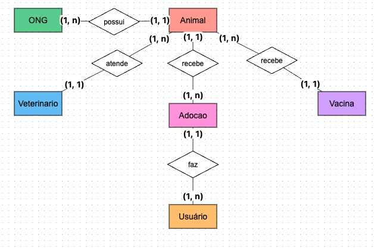
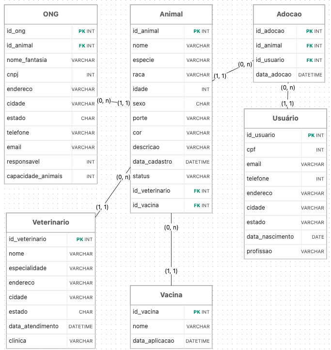

# Relatório de Banco de Dados: Sistema de Adoção de Pets 🐾

### 1. Evolução dos Bancos de Dados
<p>
A evolução dos bancos de dados começou nas décadas de 1950 e 1960 com o armazenamento primitivo em fitas magnéticas e sistemas de arquivos de texto (flat files). Essa abordagem inicial era lenta, gerava alta redundância de dados e dependia de leitura sequencial, o que dificultava cruzamentos de informações. Para resolver a crescente complexidade corporativa, surgiram os primeiros Sistemas Gerenciadores de Bancos de Dados (SGBDs) baseados nos modelos hierárquico (estruturado como uma árvore de dependências, onde um "filho" só tem um "pai") e de rede (que já permitia múltiplos relacionamentos). Embora fossem um avanço no desempenho, essas arquiteturas eram extremamente rígidas e exigiam a reescrita de aplicações inteiras caso a estrutura de dados mudasse.
</p>

<p>
O grande marco histórico ocorreu em 1970, quando Edgar F. Codd, pesquisador da IBM, propôs o Modelo Relacional. Esta abordagem revolucionou a tecnologia ao separar a estrutura lógica do armazenamento físico. Em vez de ponteiros complexos de navegação, os dados passaram a ser organizados em tabelas (entidades) bidimensionais, interligadas por chaves primárias e estrangeiras — exatamente a tecnologia aplicada neste projeto do sistema de adoção. Essa padronização, impulsionada pela linguagem SQL, garantiu maior integridade, consistência (regras ACID) e flexibilidade nas consultas, tornando os bancos de dados relacionais (como SQL Server, Oracle e MySQL) o padrão absoluto do mercado.
</p>

<p>
Com a explosão da internet, do Big Data e das redes sociais nos anos 2000, o volume massivo e a variedade de informações exigiram novas abordagens que o modelo relacional tinha dificuldade em escalar horizontalmente a baixo custo. Surgiram assim os bancos de dados NoSQL (Not Only SQL), como MongoDB e Cassandra. Criados para oferecer alta escalabilidade e lidar com dados não estruturados ou semiestruturados, eles adotam formatos flexíveis como documentos, grafos, colunas e chave-valor. Atualmente, o mercado opera em um ecossistema híbrido: bancos relacionais continuam essenciais para transações consistentes e regras de negócio estruturadas, enquanto o NoSQL domina cenários de hiper-escala e agilidade no desenvolvimento.
</p>

### 2. Modelagem de Dados

#### Modelo Conceitual / Lógico
Abaixo está o Diagrama Entidade-Relacionamento (DER) que define as regras de negócio e cardinalidades (1:N) do sistema de adoção:

<table>
  <tr>
    <td align="center"></td>
    <td align="center"></td>
  </tr>
</table>

### 3. Modelo Físico e Código Comentado

O modelo físico foi implementado em **SQL Server**. Abaixo estão os códigos comentados e a evidência de execução.

#### Criação das Tabelas Base
```sql
-- Cria o banco de dados AdocaoPets
-- Configuração de texto: 
-- CI (Case-Insensitive): Ignora maiúsculas/minúsculas (Ex: 'cachorro' = 'Cachorro')
-- AS (Accent-Sensitive): Diferencia acentos (Ex: 'Adocao' diferente de 'Adoção')
CREATE DATABASE AdocaoPets
COLLATE Latin1_General_CI_AS;
GO

-- Seleciona o Banco de Dados AdocaoPets
USE AdocaoPets;
GO

-- Cria a tabela Ong (entidade) e seus atributos no Banco de Dados AdocaoPets
CREATE TABLE Ong (
    id INT IDENTITY(1,1) PRIMARY KEY,
    nome_fantasia VARCHAR(200) NOT NULL,
    cnpj VARCHAR(14) UNIQUE NOT NULL,
    endereco VARCHAR(300) NOT NULL,
    cidade VARCHAR(100) NOT NULL,
    estado CHAR(2) NOT NULL,
    telefone VARCHAR(15) NOT NULL,
    email VARCHAR(100) NOT NULL,
    responsavel VARCHAR(200),
    capacidade_animais INT,
    data_cadastro DATETIME DEFAULT GETDATE()
);
GO

-- Cria a tabela Veterinario (entidade) e seus atributos no Banco de Dados AdocaoPets
CREATE TABLE Veterinario (
    id INT IDENTITY(1,1) PRIMARY KEY,
    nome VARCHAR(200) NOT NULL,
    crmv VARCHAR(10) UNIQUE NOT NULL,
    endereco VARCHAR(300) NOT NULL,
    cidade VARCHAR(100) NOT NULL,
    estado CHAR(2) NOT NULL,
    telefone VARCHAR(15) NOT NULL,
    email VARCHAR(100) NOT NULL
);
GO

-- Cria a tabela Vacina (entidade) e seus atributos no Banco de Dados AdocaoPets
CREATE TABLE Vacina (
    id INT IDENTITY(1,1) PRIMARY KEY,
    nome_vacina VARCHAR(100) NOT NULL,
    fabricante VARCHAR(100) NOT NULL,
    data_validade DATE NOT NULL,
    data_aplicacao DATETIME DEFAULT GETDATE()
);
GO

-- Cria a tabela Usuario (entidade) e seus atributos no Banco de Dados AdocaoPets
CREATE TABLE Usuario (
    id INT IDENTITY(1,1) PRIMARY KEY,
    nome VARCHAR(200) NOT NULL,
    email VARCHAR(100) NOT NULL,
    telefone VARCHAR(15) NOT NULL,
    endereco VARCHAR(300) NOT NULL,
    cidade VARCHAR(100) NOT NULL,
    estado CHAR(2) NOT NULL
);
GO

-- Cria a tabela Animal (entidade) e seus atributos no Banco de Dados AdocaoPets
CREATE TABLE Animal (
    id INT IDENTITY(1,1) PRIMARY KEY,
    nome_pet VARCHAR(100) NOT NULL,
    dt_nascimento DATE NOT NULL,
    especie VARCHAR(50) NOT NULL,
    raca VARCHAR(50) NOT NULL,
    idade INT NOT NULL,
    peso DECIMAL(5,2) NOT NULL,
    sexo CHAR(1) NOT NULL,
    cor VARCHAR(50) NOT NULL,
    castrado BIT NOT NULL DEFAULT 0,
    data_cadastro DATETIME DEFAULT GETDATE(),
    
    id_ong INT,
    id_veterinario INT,
    id_vacina INT,

    -- Cria as chaves estrangeiras para relacionar o Animal à ONG, ao Veterinário e à Vacina
    FOREIGN KEY (id_ong) REFERENCES Ong(id),
    FOREIGN KEY (id_veterinario) REFERENCES Veterinario(id),
    FOREIGN KEY (id_vacina) REFERENCES Vacina(id)
);
GO

-- Cria a tabela Adocao (entidade) e seus atributos no Banco de Dados AdocaoPets
CREATE TABLE Adocao (
    id INT IDENTITY(1,1) PRIMARY KEY,
    id_usuario INT NOT NULL,
    id_animal INT NOT NULL,
    data_adocao DATETIME DEFAULT GETDATE(),

    -- Cria as chaves estrangeiras para relacionar a Adoção à Usuário e ao Animal
    FOREIGN KEY (id_usuario) REFERENCES Usuario(id),
    FOREIGN KEY (id_animal) REFERENCES Animal(id)
);
GO
```