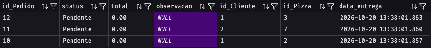
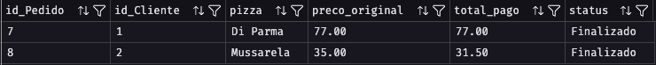
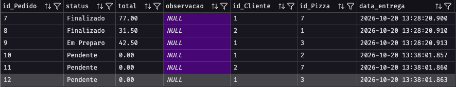
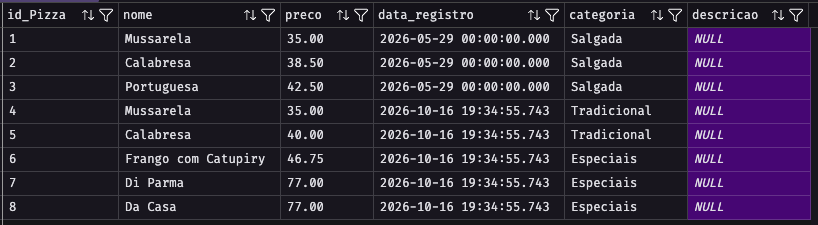

<div class="book-navigation">
  <a href="../roteiro06/README.md">← Capítulo anterior</a> ·
  <a href="../README.md">📖 Sumário</a> ·
  <a href="../roteiro08/README.md">Próximo capítulo →</a>
</div>

---

# Relatório Prático — Stored Procedures: Bella Napoli

## 1. Objetivo e ambiente

Automatizar o registro de pedidos e o fechamento de contas da pizzaria Bella Napoli por meio de stored procedures, utilizando o SQL Server e a linguagem T-SQL. A solução registra pedidos com o status **Em Preparação**, utiliza a data atual e aplica desconto de 10% no fechamento de contas de clientes VIP.

No SQL Server, as procedures são executadas com `EXEC`, equivalente ao comando `CALL` mencionado no enunciado. Os parâmetros de entrada são declarados com `@`; a palavra `IN` não é utilizada nessa sintaxe.

## 2. Scripts SQL das procedures

A procedure `sp_registrar_pedido` recebe os identificadores do cliente e da pizza e insere um pedido. O total começa em zero e é calculado no fechamento. A procedure `sp_fechar_conta` recebe o identificador do pedido e um parâmetro que indica se o cliente é VIP: `1` aplica desconto e `0` mantém o preço integral. O cálculo `preco * 0.90` corresponde a 90% do preço original.

```sql
USE BellaNapoli;
GO

-- Registra um pedido com a data atual e o status solicitado.
CREATE PROCEDURE dbo.sp_registrar_pedido
    @p_id_cliente INT,
    @p_id_pizza INT
AS
BEGIN
    SET NOCOUNT ON;

    INSERT INTO dbo.Pedido
        (id_Cliente, id_Pizza, status, total, data_entrega)
    VALUES
        (@p_id_cliente, @p_id_pizza, N'Em Preparação', 0.00, GETDATE());
END;
GO

-- Calcula o valor da conta e aplica 10% de desconto para VIP.
CREATE PROCEDURE dbo.sp_fechar_conta
    @p_id_pedido INT,
    @p_is_vip BIT = 0
AS
BEGIN
    SET NOCOUNT ON;

    DECLARE @v_preco DECIMAL(10, 2);
    DECLARE @v_total DECIMAL(10, 2);

    SELECT @v_preco = p.preco
    FROM dbo.Pedido AS ped
    INNER JOIN dbo.Pizza AS p ON p.id_Pizza = ped.id_Pizza
    WHERE ped.id_Pedido = @p_id_pedido;

    IF @v_preco IS NULL
    BEGIN
        THROW 50001, N'Pedido inexistente ou pizza sem preço cadastrado.', 1;
    END;

    IF @p_is_vip = 1
    BEGIN
        SET @v_total = @v_preco * 0.90;
    END
    ELSE
    BEGIN
        SET @v_total = @v_preco;
    END;

    UPDATE dbo.Pedido
    SET status = N'Finalizado',
        total = @v_total
    WHERE id_Pedido = @p_id_pedido;
END;
GO
```

Os parâmetros utilizados são de entrada. Embora os critérios mencionem parâmetros `IN` e `OUT`, os desafios transcritos solicitam apenas entradas, e esta solução não utiliza parâmetro de saída. No SQL Server, um parâmetro de saída seria declarado com `OUTPUT`.

## 3. Execução e validação

Execute o bloco abaixo após criar as procedures. As consultas permitem verificar os pedidos antes e depois do fechamento e comparar o valor final com o valor esperado.

```sql
/* EXECUTA A STORED PROCEDURE PARA REGISTRAR PEDIDOS */
EXEC sp_registrar_pedido @p_id_cliente = 1, @p_id_pizza = 2;
EXEC sp_registrar_pedido @p_id_cliente = 2, @p_id_pizza = 7;
EXEC sp_registrar_pedido @p_id_cliente = 1, @p_id_pizza = 3;

-- VALIDANDO O RESULTADO: CONSULTA NA PROCEDURE DE SP_REGISTRAR_PEDIDO PARA CONFIRMAR A INSERÇÃO DOS PEDIDOS
SELECT TOP 3 *
FROM Pedido
ORDER BY data_entrega DESC;
GO

/* AMPLIAÇÃO DO DESAFIO: GESTÃO FINANCEIRA */
CREATE PROCEDURE sp_fechar_conta
    @p_id_pedido INT,
    @p_is_vip BIT = 0 -- 1 para VIP (10% de desconto), 0 para Normal
AS
BEGIN
    SET NOCOUNT ON;

    -- Declara variáveis para armazenar o preço da pizza e o total do pedido
    DECLARE @v_preco DECIMAL(10, 2);
    DECLARE @v_total DECIMAL(10, 2);

    -- Busca o preço da pizza associada ao pedido
    SELECT @v_preco = p.preco
    FROM Pedido ped
    INNER JOIN Pizza p ON ped.id_Pizza = p.id_Pizza
    WHERE ped.id_Pedido = @p_id_pedido;

    -- Calcula o desconto de 10% usando operador aritmético, se o cliente for VIP
    IF @p_is_vip = 1
    BEGIN
        SET @v_total = @v_preco * 0.90; -- Desconto de 10% para clientes VIP
    END
    ELSE
    BEGIN
        SET @v_total = @v_preco; -- Sem desconto para clientes normais
    END

    -- Atualiza o status do pedido para 'Finalizado' e registra o total calculado
    UPDATE Pedido
    SET status = 'Finalizado',
        total = @v_total -- Atualiza o total do pedido com o valor calculado
    WHERE id_Pedido = @p_id_pedido; -- Filtra pelo ID do pedido fornecido como parâmetro
END;
GO

-- EXECUTA A STORED PROCEDURE PARA FECHAR A CONTA DE UM PEDIDO
EXEC sp_fechar_conta @p_id_pedido = 7, @p_is_vip = 0;
GO

-- EXECUTA A STORED PROCEDURE PARA FECHAR A CONTA DE UM PEDIDO COM DESCONTO VIP
EXEC sp_fechar_conta @p_id_pedido = 8, @p_is_vip = 1;
GO

-- VALIDAÇÃO: CONSULTA PARA CONFIRMAR O FECHAMENTO DAS CONTAS E O CÁLCULO DO TOTAL
SELECT 
    ped.id_Pedido,
    ped.id_Cliente,
    p.nome AS pizza,
    p.preco AS preco_original,
    ped.total AS total_pago,
    ped.status
FROM dbo.Pedido ped
INNER JOIN dbo.Pizza p ON ped.id_Pizza = p.id_Pizza
WHERE ped.id_Pedido IN (7, 8);
```

### Resultados esperados

- Os três pedidos devem ser registrados com status **Em Preparação**, total inicial de zero e data atual.
- O pedido fechado sem benefício VIP deve apresentar status **Finalizado** e total igual ao preço da pizza.
- O pedido fechado como VIP deve apresentar status **Finalizado** e total equivalente a 90% do preço da pizza, arredondado para duas casas decimais.
- O terceiro pedido permanece **Em Preparação**, pois não foi fechado nos testes.
- Os preços na tabela `Pizza` permanecem iguais: o desconto é registrado no total do pedido.

### Capturas de tela da execução

> Evidências pendentes: substituir as indicações abaixo pelas capturas reais do SQL Server antes da entrega. Os resultados acima são expectativas de validação, não resultados de uma execução realizada neste relatório.

**Figura 1 — Registro dos pedidos:**


**Figura 2 — Fechamento das contas:**


**Figura 3 — Consulta às pizzas:**



## 5. Análise crítica

As stored procedures facilitam a rotina do pizzaiolo porque padronizam o registro dos pedidos, garantindo que cada novo pedido entre com o status Em Preparação e a data atual, sem exigir o preenchimento manual dessas informações. Isso ajuda a identificar os pedidos que ainda precisam ser preparados e reduz erros de cadastro. No atendimento e no caixa, o fechamento automatizado calcula o valor e aplica o desconto VIP de maneira consistente, reduzindo contas manuais e permitindo que a equipe se concentre no preparo e na entrega. Nesta solução, a identificação VIP depende da informação fornecida pelo atendente; consultar essa condição no cadastro do cliente seria uma melhoria para reduzir erros de preenchimento.

---

<div class="book-navigation">
  <a href="../roteiro06/README.md">← Capítulo anterior</a> ·
  <a href="../README.md">📖 Sumário</a> ·
  <a href="../roteiro08/README.md">Próximo capítulo →</a>
</div>
