# Roteiro 01 — Portas lógicas e CircuitVerse

**Bruno Neves · Ciência da Computação · UNIP · 1º semestre**

## Conceito

Uma porta lógica transforma uma ou mais entradas binárias em uma saída. O CircuitVerse permite ligar entradas, portas e saídas para observar esse comportamento. Testar todas as combinações evita concluir o funcionamento de uma porta a partir de um único exemplo.

## Experimente as portas

Escolha a porta, defina a quantidade de entradas e alterne os bits. A linha destacada corresponde ao estado atual do circuito.

## Como ler os símbolos

`0` e `1` representam os níveis lógicos. `¬A` inverte A; `A·B` significa AND; `A+B` significa OR; `A ⊕ B` significa XOR. O sinal + nas expressões booleanas não é uma soma aritmética. Uma tabela com n entradas tem 2ⁿ combinações.
## Funcionamento das seis portas

| Porta | Regra de saída 1 |
| --- | --- |
| AND | Todas as entradas são 1. |
| NAND | Pelo menos uma entrada é 0; é a inversa de AND. |
| OR | Pelo menos uma entrada é 1. |
| NOR | Todas as entradas são 0; é a inversa de OR. |
| XOR | A quantidade de entradas em 1 é ímpar. Com duas entradas, elas são diferentes. |
| XNOR / NXOR | A quantidade de entradas em 1 é par; é a inversa de XOR. Com duas entradas, elas são iguais. |

## Tabelas-verdade conferidas

As tabelas de algumas portas no relatório original repetem a coluna de saída de AND. As tabelas abaixo usam a função de cada porta; as capturas são mantidas como registro da atividade.

### 2 entradas

| A | B | AND | NAND | OR | NOR | XOR | XNOR |
| --- | --- | --- | --- | --- | --- | --- | --- |
| 0 | 0 | 0 | 1 | 0 | 1 | 0 | 1 |
| 0 | 1 | 0 | 1 | 1 | 0 | 1 | 0 |
| 1 | 0 | 0 | 1 | 1 | 0 | 1 | 0 |
| 1 | 1 | 1 | 0 | 1 | 0 | 0 | 1 |

### 3 entradas

| A | B | C | AND | NAND | OR | NOR | XOR | XNOR |
| --- | --- | --- | --- | --- | --- | --- | --- | --- |
| 0 | 0 | 0 | 0 | 1 | 0 | 1 | 0 | 1 |
| 0 | 0 | 1 | 0 | 1 | 1 | 0 | 1 | 0 |
| 0 | 1 | 0 | 0 | 1 | 1 | 0 | 1 | 0 |
| 0 | 1 | 1 | 0 | 1 | 1 | 0 | 0 | 1 |
| 1 | 0 | 0 | 0 | 1 | 1 | 0 | 1 | 0 |
| 1 | 0 | 1 | 0 | 1 | 1 | 0 | 0 | 1 |
| 1 | 1 | 0 | 0 | 1 | 1 | 0 | 0 | 1 |
| 1 | 1 | 1 | 1 | 0 | 1 | 0 | 1 | 0 |

### 4 entradas

| A | B | C | D | AND | NAND | OR | NOR | XOR | XNOR |
| --- | --- | --- | --- | --- | --- | --- | --- | --- | --- |
| 0 | 0 | 0 | 0 | 0 | 1 | 0 | 1 | 0 | 1 |
| 0 | 0 | 0 | 1 | 0 | 1 | 1 | 0 | 1 | 0 |
| 0 | 0 | 1 | 0 | 0 | 1 | 1 | 0 | 1 | 0 |
| 0 | 0 | 1 | 1 | 0 | 1 | 1 | 0 | 0 | 1 |
| 0 | 1 | 0 | 0 | 0 | 1 | 1 | 0 | 1 | 0 |
| 0 | 1 | 0 | 1 | 0 | 1 | 1 | 0 | 0 | 1 |
| 0 | 1 | 1 | 0 | 0 | 1 | 1 | 0 | 0 | 1 |
| 0 | 1 | 1 | 1 | 0 | 1 | 1 | 0 | 1 | 0 |
| 1 | 0 | 0 | 0 | 0 | 1 | 1 | 0 | 1 | 0 |
| 1 | 0 | 0 | 1 | 0 | 1 | 1 | 0 | 0 | 1 |
| 1 | 0 | 1 | 0 | 0 | 1 | 1 | 0 | 0 | 1 |
| 1 | 0 | 1 | 1 | 0 | 1 | 1 | 0 | 1 | 0 |
| 1 | 1 | 0 | 0 | 0 | 1 | 1 | 0 | 0 | 1 |
| 1 | 1 | 0 | 1 | 0 | 1 | 1 | 0 | 1 | 0 |
| 1 | 1 | 1 | 0 | 0 | 1 | 1 | 0 | 1 | 0 |
| 1 | 1 | 1 | 1 | 1 | 0 | 1 | 0 | 0 | 1 |

## Registros da atividade

As imagens abaixo preservam as capturas do relatório original. Clique em uma imagem no livro para ampliá-la.

<figure>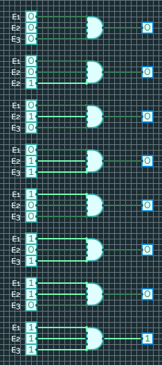<figcaption>AND — registro original, página 2, imagem 1.</figcaption></figure>
<figure>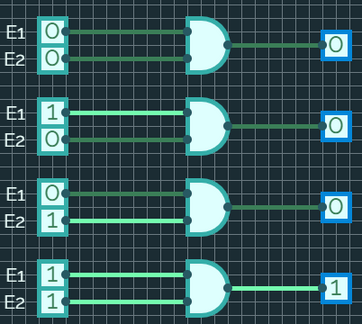<figcaption>AND — registro original, página 2, imagem 2.</figcaption></figure>
<figure>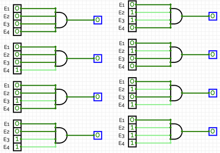<figcaption>AND — registro original, página 3, imagem 1.</figcaption></figure>
<figure>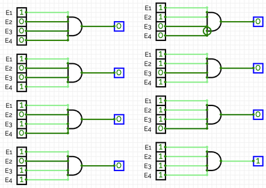<figcaption>AND — registro original, página 3, imagem 2.</figcaption></figure>
<figure>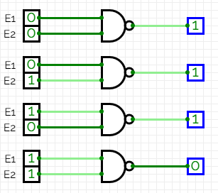<figcaption>NAND — registro original, página 4, imagem 1.</figcaption></figure>
<figure>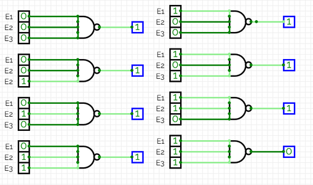<figcaption>NAND — registro original, página 4, imagem 2.</figcaption></figure>
<figure>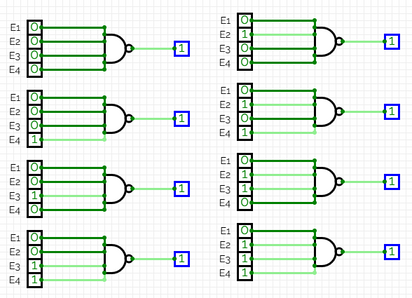<figcaption>NAND — registro original, página 5, imagem 1.</figcaption></figure>
<figure>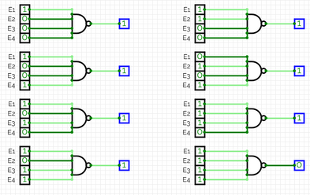<figcaption>NAND — registro original, página 5, imagem 2.</figcaption></figure>
<figure>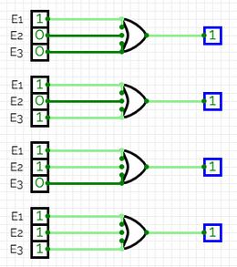<figcaption>OR — registro original, página 6, imagem 1.</figcaption></figure>
<figure>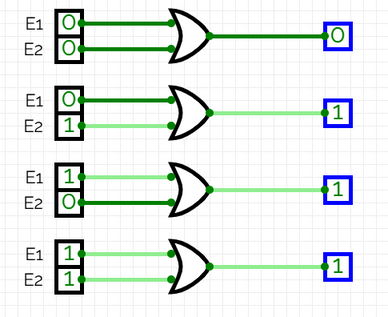<figcaption>OR — registro original, página 6, imagem 2.</figcaption></figure>
<figure>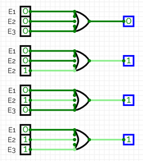<figcaption>OR — registro original, página 6, imagem 3.</figcaption></figure>
<figure>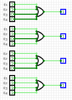<figcaption>OR — registro original, página 7, imagem 1.</figcaption></figure>
<figure>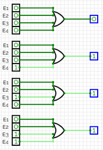<figcaption>OR — registro original, página 7, imagem 2.</figcaption></figure>
<figure>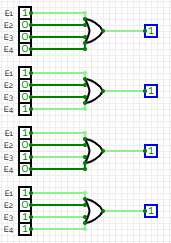<figcaption>OR — registro original, página 7, imagem 3.</figcaption></figure>
<figure>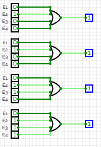<figcaption>OR — registro original, página 7, imagem 4.</figcaption></figure>
<figure>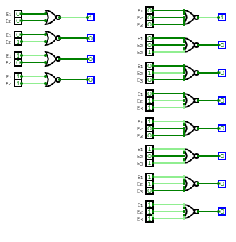<figcaption>NOR — registro original, página 8, imagem 1.</figcaption></figure>
<figure>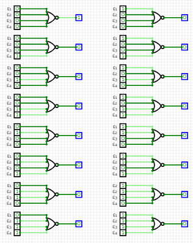<figcaption>NOR — registro original, página 9, imagem 1.</figcaption></figure>
<figure>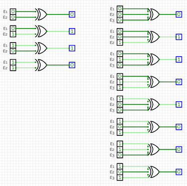<figcaption>XOR — registro original, página 10, imagem 1.</figcaption></figure>
<figure>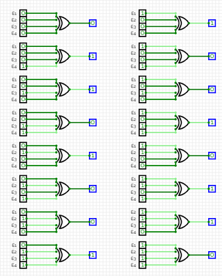<figcaption>XOR — registro original, página 11, imagem 1.</figcaption></figure>
<figure>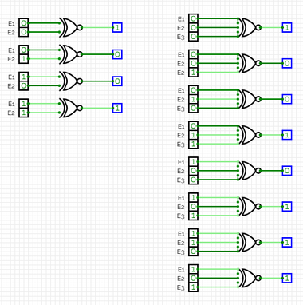<figcaption>XNOR — registro original, página 12, imagem 1.</figcaption></figure>
<figure>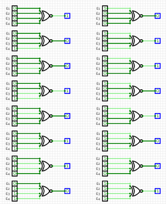<figcaption>XNOR — registro original, página 13, imagem 1.</figcaption></figure>

## O que observar na prática

Conectar uma entrada a várias portas não altera o valor do sinal. Em NAND e NOR, a bolha no terminal representa a inversão da saída. Para mais de duas entradas, XOR expressa paridade ímpar; não significa apenas “uma entrada ligada”. Por exemplo, XOR(1,1,1) = 1.

**Consulta técnica:** [documentação oficial das portas do CircuitVerse](https://docs.circuitverse.org/chapter4/chapter4-gates/) e [implementação oficial da porta XOR](https://github.com/CircuitVerse/CircuitVerse/blob/master/simulator/src/modules/XorGate.js).

**Referências:** UNIP, Circuitos Lógicos Digitais, roteiro 1. Capturas: relatório de aulas práticas fornecido pelo autor. As tabelas do livro foram calculadas a partir das expressões indicadas; as visualizações interativas são demonstrações didáticas.
