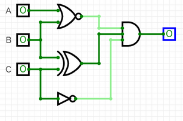
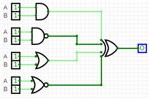
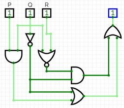
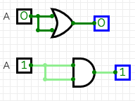
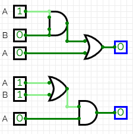
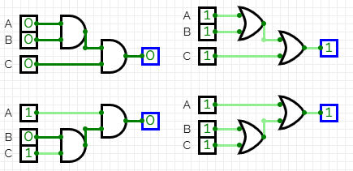
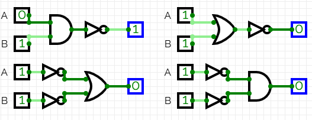

# Roteiro 02 — Construção e equivalência de circuitos

**Bruno Neves · Ciência da Computação · UNIP · 1º semestre**

## Conceito

Construir um circuito exige respeitar os parênteses e as negações da expressão. AND representa o produto lógico, OR reúne alternativas e NOT inverte um sinal. Dois circuitos são equivalentes quando produzem a mesma saída em todas as combinações das entradas.

## Compare os circuitos

O laboratório percorre as expressões e os esquemas da atividade. Altere os bits para comparar a saída original com a expressão simplificada.

## Expressões e tabelas conferidas

As expressões foram conferidas com os símbolos do roteiro. No item I-b, a negação abrange todo o produto R·Q. No item II-a, a primeira porta é NOR; essa associação resulta em saída constante 0. No item II-b, AND e NAND se complementam, assim como OR e NOR, levando também a 0 na XOR final.

### Parte I — expressão A

`S = ¬A·¬B + A·¬C + ¬A·C`

**Equivalente:** `S = ¬A·¬B + ¬A·C + A·¬C`.

| A | B | C | S |
| --- | --- | --- | --- |
| 0 | 0 | 0 | 1 |
| 0 | 0 | 1 | 1 |
| 0 | 1 | 0 | 0 |
| 0 | 1 | 1 | 1 |
| 1 | 0 | 0 | 1 |
| 1 | 0 | 1 | 0 |
| 1 | 1 | 0 | 1 |
| 1 | 1 | 1 | 0 |

### Parte I — expressão B

`S = P·¬Q + P·¬(R·Q) + (¬P ⊕ R)`

**Equivalente:** `S = P + ¬R`.

| P | Q | R | S |
| --- | --- | --- | --- |
| 0 | 0 | 0 | 1 |
| 0 | 0 | 1 | 0 |
| 0 | 1 | 0 | 1 |
| 0 | 1 | 1 | 0 |
| 1 | 0 | 0 | 1 |
| 1 | 0 | 1 | 1 |
| 1 | 1 | 0 | 1 |
| 1 | 1 | 1 | 1 |

### Parte II — circuito A

`S = ¬(A+B)·(B ⊕ C)·¬C`

**Equivalente:** `S = 0`.

| A | B | C | S |
| --- | --- | --- | --- |
| 0 | 0 | 0 | 0 |
| 0 | 0 | 1 | 0 |
| 0 | 1 | 0 | 0 |
| 0 | 1 | 1 | 0 |
| 1 | 0 | 0 | 0 |
| 1 | 0 | 1 | 0 |
| 1 | 1 | 0 | 0 |
| 1 | 1 | 1 | 0 |

### Parte II — circuito B

`S = (A·B) ⊕ ¬(A·B) ⊕ (A+B) ⊕ ¬(A+B)`

**Equivalente:** `S = 0`.

| A | B | S |
| --- | --- | --- |
| 0 | 0 | 0 |
| 0 | 1 | 0 |
| 1 | 0 | 0 |
| 1 | 1 | 0 |

### Parte II — circuito C

`S = P·Q + ¬Q + ¬Q·¬(Q+R)`

**Equivalente:** `S = P + ¬Q`.

| P | Q | R | S |
| --- | --- | --- | --- |
| 0 | 0 | 0 | 1 |
| 0 | 0 | 1 | 1 |
| 0 | 1 | 0 | 0 |
| 0 | 1 | 1 | 0 |
| 1 | 0 | 0 | 1 |
| 1 | 0 | 1 | 1 |
| 1 | 1 | 0 | 1 |
| 1 | 1 | 1 | 1 |

## Leis da álgebra booleana

| Lei | Equivalências |
| --- | --- |
| Idempotência | A+A = A; A·A = A. |
| Absorção | A+A·B = A; A·(A+B) = A. |
| Associatividade | (A·B)·C = A·(B·C); (A+B)+C = A+(B+C). |
| De Morgan | ¬(A·B) = ¬A+¬B; ¬(A+B) = ¬A·¬B. |

## Ampliação: XOR usando NOT, AND e OR

`P ⊕ Q = ¬P·Q + P·¬Q`. A saída vale 1 somente quando P e Q são diferentes.

`¬(P ⊕ Q) = P·Q + ¬P·¬Q`. A saída vale 1 quando P e Q são iguais.

| P | Q | XOR | XNOR |
| --- | --- | --- | --- |
| 0 | 0 | 0 | 1 |
| 0 | 1 | 1 | 0 |
| 1 | 0 | 1 | 0 |
| 1 | 1 | 0 | 1 |

## Registros da atividade

As imagens abaixo preservam as capturas do relatório original. Clique em uma imagem no livro para ampliá-la.

<figure><figcaption>Circuito a — registro original, página 16, imagem 1.</figcaption></figure>
<figure><figcaption>Circuito b — registro original, página 17, imagem 1.</figcaption></figure>
<figure><figcaption>Circuito c — registro original, página 18, imagem 1.</figcaption></figure>
<figure><figcaption>Leis idempotencia absorcao — registro original, página 19, imagem 1.</figcaption></figure>
<figure><figcaption>Leis idempotencia absorcao — registro original, página 19, imagem 2.</figcaption></figure>
<figure><figcaption>Lei associativa — registro original, página 20, imagem 1.</figcaption></figure>
<figure><figcaption>Leis de morgan — registro original, página 21, imagem 1.</figcaption></figure>

**Referências:** UNIP, Circuitos Lógicos Digitais, roteiro 2. Capturas: relatório de aulas práticas fornecido pelo autor. As tabelas do livro foram calculadas a partir das expressões indicadas; as visualizações interativas são demonstrações didáticas.
