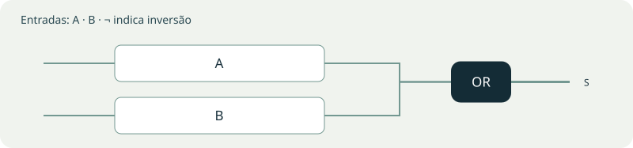
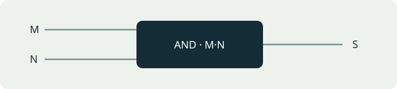
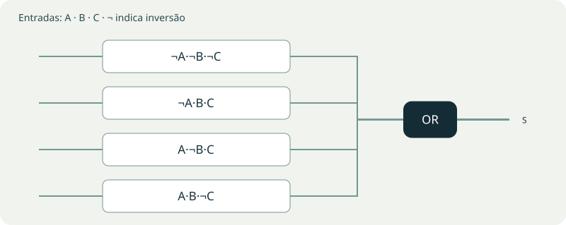
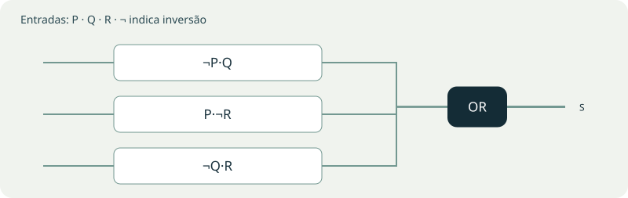
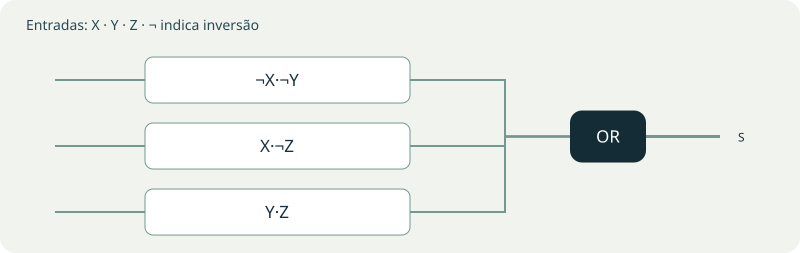
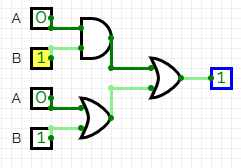
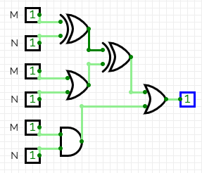
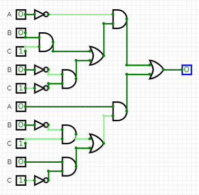
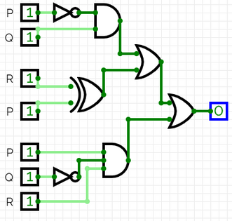
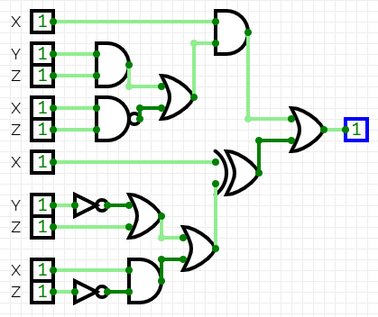

# Roteiro 03 — Karnaugh com duas e três variáveis

**Bruno Neves · Ciência da Computação · UNIP · 1º semestre**

## Conceito

O mapa de Karnaugh reorganiza a tabela-verdade para tornar visíveis as adjacências. Linhas e colunas seguem código Gray: posições vizinhas diferem em um bit. Agrupam-se células 1 em blocos de 1, 2, 4, 8 ou 16 células, conforme o tamanho do mapa. Bordas opostas também são adjacentes, e grupos podem se sobrepor.

Uma variável que muda dentro de um grupo desaparece do produto resultante. A expressão simplificada deve preservar a saída de todas as combinações do circuito original.

## Explore os agrupamentos

Escolha um circuito e clique nas células do mapa ou alterne as entradas. As cores identificam os grupos usados na soma de produtos; uma célula pode pertencer a mais de um grupo.

## Soluções e comparação das saídas

As tabelas abaixo são resultados calculados, e não novas capturas do CircuitVerse. As colunas S e S simplificada coincidem em todas as linhas.

### Circuito I

`S = (A·B) + (A+B)`

**Soma de produtos simplificada:** `S = A + B`.

| A | B | S | S simplificada |
| --- | --- | --- | --- |
| 0 | 0 | 0 | 0 |
| 0 | 1 | 1 | 1 |
| 1 | 0 | 1 | 1 |
| 1 | 1 | 1 | 1 |

**Mapa de Karnaugh:**

| A / B | 0 | 1 |
| --- | --- | --- |
| 0 | 0 | 1 |
| 1 | 1 | 1 |

**Grupos:** G1: A; G2: B.

### Circuito II

`S = [(M ⊕ N) ⊕ (M+N)] + M·N`

**Soma de produtos simplificada:** `S = M·N`.

| M | N | S | S simplificada |
| --- | --- | --- | --- |
| 0 | 0 | 0 | 0 |
| 0 | 1 | 0 | 0 |
| 1 | 0 | 0 | 0 |
| 1 | 1 | 1 | 1 |

**Mapa de Karnaugh:**

| M / N | 0 | 1 |
| --- | --- | --- |
| 0 | 0 | 0 |
| 1 | 0 | 1 |

**Grupos:** G1: M·N.

### Circuito III

`S = ¬A·(B·C + ¬B·¬C) + A·(¬B·C + B·¬C)`

**Soma de produtos simplificada:** `S = ¬A·¬B·¬C + ¬A·B·C + A·¬B·C + A·B·¬C`.

| A | B | C | S | S simplificada |
| --- | --- | --- | --- | --- |
| 0 | 0 | 0 | 1 | 1 |
| 0 | 0 | 1 | 0 | 0 |
| 0 | 1 | 0 | 0 | 0 |
| 0 | 1 | 1 | 1 | 1 |
| 1 | 0 | 0 | 0 | 0 |
| 1 | 0 | 1 | 1 | 1 |
| 1 | 1 | 0 | 1 | 1 |
| 1 | 1 | 1 | 0 | 0 |

**Mapa de Karnaugh:**

| A / BC | 00 | 01 | 11 | 10 |
| --- | --- | --- | --- | --- |
| 0 | 1 | 0 | 1 | 0 |
| 1 | 0 | 1 | 0 | 1 |

**Grupos:** G1: ¬A·¬B·¬C; G2: ¬A·B·C; G3: A·¬B·C; G4: A·B·¬C.

### Circuito IV

`S = ¬P·Q + (R ⊕ P) + P·¬Q·R`

**Soma de produtos simplificada:** `S = ¬P·Q + P·¬R + ¬Q·R`.

| P | Q | R | S | S simplificada |
| --- | --- | --- | --- | --- |
| 0 | 0 | 0 | 0 | 0 |
| 0 | 0 | 1 | 1 | 1 |
| 0 | 1 | 0 | 1 | 1 |
| 0 | 1 | 1 | 1 | 1 |
| 1 | 0 | 0 | 1 | 1 |
| 1 | 0 | 1 | 1 | 1 |
| 1 | 1 | 0 | 1 | 1 |
| 1 | 1 | 1 | 0 | 0 |

**Mapa de Karnaugh:**

| P / QR | 00 | 01 | 11 | 10 |
| --- | --- | --- | --- | --- |
| 0 | 0 | 1 | 1 | 1 |
| 1 | 1 | 1 | 0 | 1 |

**Grupos:** G1: ¬P·Q; G2: P·¬R; G3: ¬Q·R.

### Circuito V

`S = X·(Y·Z + ¬Z·¬X) + [X ⊕ (¬Y+Z)] + X·¬Z`

**Soma de produtos simplificada:** `S = ¬X·¬Y + X·¬Z + Y·Z`.

| X | Y | Z | S | S simplificada |
| --- | --- | --- | --- | --- |
| 0 | 0 | 0 | 1 | 1 |
| 0 | 0 | 1 | 1 | 1 |
| 0 | 1 | 0 | 0 | 0 |
| 0 | 1 | 1 | 1 | 1 |
| 1 | 0 | 0 | 1 | 1 |
| 1 | 0 | 1 | 0 | 0 |
| 1 | 1 | 0 | 1 | 1 |
| 1 | 1 | 1 | 1 | 1 |

**Mapa de Karnaugh:**

| X / YZ | 00 | 01 | 11 | 10 |
| --- | --- | --- | --- | --- |
| 0 | 1 | 1 | 1 | 0 |
| 1 | 1 | 0 | 1 | 1 |

**Grupos:** G1: ¬X·¬Y; G2: X·¬Z; G3: Y·Z.

## Ampliação: outras formas equivalentes

A expressão mínima não é necessariamente única. A ordem dos produtos pode mudar; também é possível fatorar termos ou aplicar De Morgan. Compare todas as linhas da tabela antes de substituir o circuito. A quantidade de portas depende da biblioteca, do número de entradas por porta e do compartilhamento das inversões.

Para o circuito I, `A+B` também é `¬(¬A·¬B)`. O circuito II reduz a `M·N`. O circuito III corresponde à paridade par `¬(A ⊕ B ⊕ C)`, uma alternativa compacta com portas XOR e uma inversão. Trocar entre AND/OR e NAND/NOR com saídas e entradas invertidas pode manter o número de portas quando sinais complementados já estão disponíveis.

## Registros da atividade

As imagens abaixo preservam as capturas do relatório original. Clique em uma imagem no livro para ampliá-la.

<figure><figcaption>Circuitos i ii — registro original, página 22, imagem 1.</figcaption></figure>
<figure><figcaption>Circuitos i ii — registro original, página 22, imagem 2.</figcaption></figure>
<figure><figcaption>Circuito iii — registro original, página 23, imagem 1.</figcaption></figure>
<figure><figcaption>Circuito iv — registro original, página 24, imagem 1.</figcaption></figure>
<figure><figcaption>Circuito v — registro original, página 25, imagem 1.</figcaption></figure>

**Referências:** UNIP, Circuitos Lógicos Digitais, roteiro 3. Capturas: relatório de aulas práticas fornecido pelo autor. As tabelas do livro foram calculadas a partir das expressões indicadas; as visualizações interativas são demonstrações didáticas.
