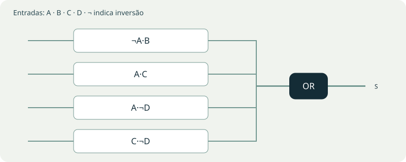
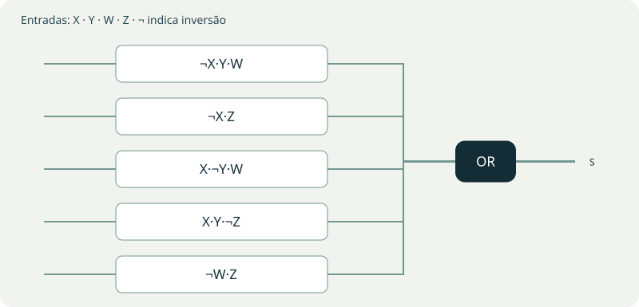
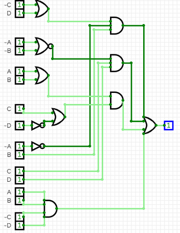
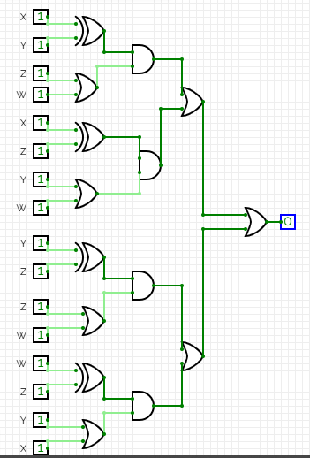

# Roteiro 04 — Karnaugh com quatro variáveis

**Bruno Neves · Ciência da Computação · UNIP · 1º semestre**

## Conceito

O mapa de Karnaugh reorganiza a tabela-verdade para tornar visíveis as adjacências. Linhas e colunas seguem código Gray: posições vizinhas diferem em um bit. Agrupam-se células 1 em blocos de 1, 2, 4, 8 ou 16 células, conforme o tamanho do mapa. Bordas opostas também são adjacentes, e grupos podem se sobrepor.

Uma variável que muda dentro de um grupo desaparece do produto resultante. A expressão simplificada deve preservar a saída de todas as combinações do circuito original.

## Explore os agrupamentos

Escolha um circuito e clique nas células do mapa ou alterne as entradas. As cores identificam os grupos usados na soma de produtos; uma célula pode pertencer a mais de um grupo.

## Soluções e comparação das saídas

As tabelas abaixo são resultados calculados, e não novas capturas do CircuitVerse. As colunas S e S simplificada coincidem em todas as linhas.

**Conferência do circuito I:** o roteiro usa ¬D no segundo e no último produto. O relatório original apresenta D nesses pontos; a formulação e as tabelas deste capítulo seguem as negações do roteiro. A ordem X,Y,W,Z do circuito II foi mantida nas tabelas e no mapa.

### Circuito I

`S = ¬A·B·(¬C+D) + (¬A+¬B)·C·¬D + (A+B)·(C+¬D) + A·B·¬C·¬D`

**Soma de produtos simplificada:** `S = ¬A·B + A·C + A·¬D + C·¬D`.

| A | B | C | D | S | S simplificada |
| --- | --- | --- | --- | --- | --- |
| 0 | 0 | 0 | 0 | 0 | 0 |
| 0 | 0 | 0 | 1 | 0 | 0 |
| 0 | 0 | 1 | 0 | 1 | 1 |
| 0 | 0 | 1 | 1 | 0 | 0 |
| 0 | 1 | 0 | 0 | 1 | 1 |
| 0 | 1 | 0 | 1 | 1 | 1 |
| 0 | 1 | 1 | 0 | 1 | 1 |
| 0 | 1 | 1 | 1 | 1 | 1 |
| 1 | 0 | 0 | 0 | 1 | 1 |
| 1 | 0 | 0 | 1 | 0 | 0 |
| 1 | 0 | 1 | 0 | 1 | 1 |
| 1 | 0 | 1 | 1 | 1 | 1 |
| 1 | 1 | 0 | 0 | 1 | 1 |
| 1 | 1 | 0 | 1 | 0 | 0 |
| 1 | 1 | 1 | 0 | 1 | 1 |
| 1 | 1 | 1 | 1 | 1 | 1 |

**Mapa de Karnaugh:**

| AB / CD | 00 | 01 | 11 | 10 |
| --- | --- | --- | --- | --- |
| 00 | 0 | 0 | 0 | 1 |
| 01 | 1 | 1 | 1 | 1 |
| 11 | 1 | 0 | 1 | 1 |
| 10 | 1 | 0 | 1 | 1 |

**Grupos:** G1: ¬A·B; G2: A·C; G3: A·¬D; G4: C·¬D.

### Circuito II

`S = (X ⊕ Y)·(Z+W) + (X ⊕ Z)·(Y+W) + (Y ⊕ Z)·(Z+W) + (W ⊕ Z)·(Y+X)`

**Soma de produtos simplificada:** `S = ¬X·Y·W + ¬X·Z + X·¬Y·W + X·Y·¬Z + ¬W·Z`.

| X | Y | W | Z | S | S simplificada |
| --- | --- | --- | --- | --- | --- |
| 0 | 0 | 0 | 0 | 0 | 0 |
| 0 | 0 | 0 | 1 | 1 | 1 |
| 0 | 0 | 1 | 0 | 0 | 0 |
| 0 | 0 | 1 | 1 | 1 | 1 |
| 0 | 1 | 0 | 0 | 0 | 0 |
| 0 | 1 | 0 | 1 | 1 | 1 |
| 0 | 1 | 1 | 0 | 1 | 1 |
| 0 | 1 | 1 | 1 | 1 | 1 |
| 1 | 0 | 0 | 0 | 0 | 0 |
| 1 | 0 | 0 | 1 | 1 | 1 |
| 1 | 0 | 1 | 0 | 1 | 1 |
| 1 | 0 | 1 | 1 | 1 | 1 |
| 1 | 1 | 0 | 0 | 1 | 1 |
| 1 | 1 | 0 | 1 | 1 | 1 |
| 1 | 1 | 1 | 0 | 1 | 1 |
| 1 | 1 | 1 | 1 | 0 | 0 |

**Mapa de Karnaugh:**

| XY / WZ | 00 | 01 | 11 | 10 |
| --- | --- | --- | --- | --- |
| 00 | 0 | 1 | 1 | 0 |
| 01 | 0 | 1 | 1 | 1 |
| 11 | 1 | 1 | 0 | 1 |
| 10 | 0 | 1 | 1 | 1 |

**Grupos:** G1: ¬X·Y·W; G2: ¬X·Z; G3: X·¬Y·W; G4: X·Y·¬Z; G5: ¬W·Z.

## Ampliação: outras formas equivalentes

A expressão mínima não é necessariamente única. A ordem dos produtos pode mudar; também é possível fatorar termos ou aplicar De Morgan. Compare todas as linhas da tabela antes de substituir o circuito. A quantidade de portas depende da biblioteca, do número de entradas por porta e do compartilhamento das inversões.

Por De Morgan, uma soma de produtos `T1+T2+…` pode ser escrita como `¬(¬T1·¬T2·…)`. Isso permite uma associação NAND–NAND equivalente à estrutura AND–OR: cada produto invertido alimenta a NAND final. Com os mesmos sinais complementados disponíveis e a mesma capacidade de entradas por porta, a contagem de portas dos dois níveis é preservada.

## Registros da atividade

As imagens abaixo preservam as capturas do relatório original. Clique em uma imagem no livro para ampliá-la.

<figure><figcaption>Circuito i — registro original, página 27, imagem 1.</figcaption></figure>
<figure><figcaption>Circuito ii — registro original, página 29, imagem 1.</figcaption></figure>

**Referências:** UNIP, Circuitos Lógicos Digitais, roteiro 4. Capturas: relatório de aulas práticas fornecido pelo autor. As tabelas do livro foram calculadas a partir das expressões indicadas; as visualizações interativas são demonstrações didáticas.
