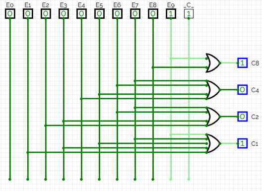
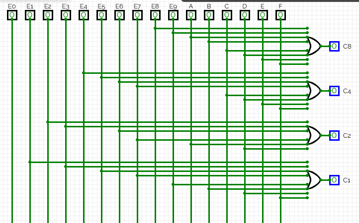

# Roteiro 05 — Codificadores e decodificadores

**Bruno Neves · Ciência da Computação · UNIP · 1º semestre**

## Conceito

Um codificador transforma uma linha ativa em um código binário. O codificador decimal deste roteiro possui dez entradas E0…E9 e quatro saídas com pesos 8,4,2,1. O hexadecimal possui dezesseis entradas E0…EF. A hipótese de funcionamento é uma única entrada ativa por vez; o circuito não estabelece prioridade entre entradas simultâneas.

O decodificador realiza o caminho inverso: lê o código e ativa a linha correspondente. Em BCD, os códigos de 10 a 15 não representam dígitos decimais.

## Experimente codificar e decodificar

## Codificador BCD 8421

**Canal 8:** `E8 + E9`.

**Canal 4:** `E4 + E5 + E6 + E7`.

**Canal 2:** `E2 + E3 + E6 + E7`.

**Canal 1:** `E1 + E3 + E5 + E7 + E9`.

| Decimal | C8 | C4 | C2 | C1 |
| --- | --- | --- | --- | --- |
| 0 | 0 | 0 | 0 | 0 |
| 1 | 0 | 0 | 0 | 1 |
| 2 | 0 | 0 | 1 | 0 |
| 3 | 0 | 0 | 1 | 1 |
| 4 | 0 | 1 | 0 | 0 |
| 5 | 0 | 1 | 0 | 1 |
| 6 | 0 | 1 | 1 | 0 |
| 7 | 0 | 1 | 1 | 1 |
| 8 | 1 | 0 | 0 | 0 |
| 9 | 1 | 0 | 0 | 1 |

## Codificador hexadecimal (BCH no roteiro)

**Canal 8:** `E8 + E9 + EA + EB + EC + ED + EE + EF`.

**Canal 4:** `E4 + E5 + E6 + E7 + EC + ED + EE + EF`.

**Canal 2:** `E2 + E3 + E6 + E7 + EA + EB + EE + EF`.

**Canal 1:** `E1 + E3 + E5 + E7 + E9 + EB + ED + EF`.

| Hexadecimal | C8 | C4 | C2 | C1 |
| --- | --- | --- | --- | --- |
| 0 | 0 | 0 | 0 | 0 |
| 1 | 0 | 0 | 0 | 1 |
| 2 | 0 | 0 | 1 | 0 |
| 3 | 0 | 0 | 1 | 1 |
| 4 | 0 | 1 | 0 | 0 |
| 5 | 0 | 1 | 0 | 1 |
| 6 | 0 | 1 | 1 | 0 |
| 7 | 0 | 1 | 1 | 1 |
| 8 | 1 | 0 | 0 | 0 |
| 9 | 1 | 0 | 0 | 1 |
| A | 1 | 0 | 1 | 0 |
| B | 1 | 0 | 1 | 1 |
| C | 1 | 1 | 0 | 0 |
| D | 1 | 1 | 0 | 1 |
| E | 1 | 1 | 1 | 0 |
| F | 1 | 1 | 1 | 1 |

**Conferência:** no código hexadecimal, EB deve participar dos canais 1, 2 e 8. As expressões acima incluem todas as entradas correspondentes, corrigindo a omissão no canal 2 do relatório original.

## Ampliação: decodificador BCD

Para cada dígito, forme um produto que reconheça os quatro bits. Por exemplo, `S0 = ¬C8·¬C4·¬C2·¬C1` e `S9 = C8·¬C4·¬C2·C1`. As expressões podem ser reduzidas com os estados 10…15 como indiferentes (X), desde que essas entradas não sejam utilizadas.

### Saída S0

`S0 = ¬C8·¬C4·¬C2·¬C1` — forma reduzida para entradas BCD válidas.

| C8C4 / C2C1 | 00 | 01 | 11 | 10 |
| --- | --- | --- | --- | --- |
| 00 | 1 | 0 | 0 | 0 |
| 01 | 0 | 0 | 0 | 0 |
| 11 | X | X | X | X |
| 10 | 0 | 0 | X | X |

### Saída S1

`S1 = ¬C8·¬C4·¬C2·C1` — forma reduzida para entradas BCD válidas.

| C8C4 / C2C1 | 00 | 01 | 11 | 10 |
| --- | --- | --- | --- | --- |
| 00 | 0 | 1 | 0 | 0 |
| 01 | 0 | 0 | 0 | 0 |
| 11 | X | X | X | X |
| 10 | 0 | 0 | X | X |

### Saída S2

`S2 = ¬C4·C2·¬C1` — forma reduzida para entradas BCD válidas.

| C8C4 / C2C1 | 00 | 01 | 11 | 10 |
| --- | --- | --- | --- | --- |
| 00 | 0 | 0 | 0 | 1 |
| 01 | 0 | 0 | 0 | 0 |
| 11 | X | X | X | X |
| 10 | 0 | 0 | X | X |

### Saída S3

`S3 = ¬C4·C2·C1` — forma reduzida para entradas BCD válidas.

| C8C4 / C2C1 | 00 | 01 | 11 | 10 |
| --- | --- | --- | --- | --- |
| 00 | 0 | 0 | 1 | 0 |
| 01 | 0 | 0 | 0 | 0 |
| 11 | X | X | X | X |
| 10 | 0 | 0 | X | X |

### Saída S4

`S4 = C4·¬C2·¬C1` — forma reduzida para entradas BCD válidas.

| C8C4 / C2C1 | 00 | 01 | 11 | 10 |
| --- | --- | --- | --- | --- |
| 00 | 0 | 0 | 0 | 0 |
| 01 | 1 | 0 | 0 | 0 |
| 11 | X | X | X | X |
| 10 | 0 | 0 | X | X |

### Saída S5

`S5 = C4·¬C2·C1` — forma reduzida para entradas BCD válidas.

| C8C4 / C2C1 | 00 | 01 | 11 | 10 |
| --- | --- | --- | --- | --- |
| 00 | 0 | 0 | 0 | 0 |
| 01 | 0 | 1 | 0 | 0 |
| 11 | X | X | X | X |
| 10 | 0 | 0 | X | X |

### Saída S6

`S6 = C4·C2·¬C1` — forma reduzida para entradas BCD válidas.

| C8C4 / C2C1 | 00 | 01 | 11 | 10 |
| --- | --- | --- | --- | --- |
| 00 | 0 | 0 | 0 | 0 |
| 01 | 0 | 0 | 0 | 1 |
| 11 | X | X | X | X |
| 10 | 0 | 0 | X | X |

### Saída S7

`S7 = C4·C2·C1` — forma reduzida para entradas BCD válidas.

| C8C4 / C2C1 | 00 | 01 | 11 | 10 |
| --- | --- | --- | --- | --- |
| 00 | 0 | 0 | 0 | 0 |
| 01 | 0 | 0 | 1 | 0 |
| 11 | X | X | X | X |
| 10 | 0 | 0 | X | X |

### Saída S8

`S8 = C8·¬C1` — forma reduzida para entradas BCD válidas.

| C8C4 / C2C1 | 00 | 01 | 11 | 10 |
| --- | --- | --- | --- | --- |
| 00 | 0 | 0 | 0 | 0 |
| 01 | 0 | 0 | 0 | 0 |
| 11 | X | X | X | X |
| 10 | 1 | 0 | X | X |

### Saída S9

`S9 = C8·C1` — forma reduzida para entradas BCD válidas.

| C8C4 / C2C1 | 00 | 01 | 11 | 10 |
| --- | --- | --- | --- | --- |
| 00 | 0 | 0 | 0 | 0 |
| 01 | 0 | 0 | 0 | 0 |
| 11 | X | X | X | X |
| 10 | 0 | 1 | X | X |

**Estados inválidos:** nas formas reduzidas, as saídas para 10…15 não são especificadas. Para tornar a demonstração previsível, o laboratório bloqueia todas as saídas nessas entradas.

| C8 | C4 | C2 | C1 | S0 | S1 | S2 | S3 | S4 | S5 | S6 | S7 | S8 | S9 |
| --- | --- | --- | --- | --- | --- | --- | --- | --- | --- | --- | --- | --- | --- |
| 0 | 0 | 0 | 0 | 1 | 0 | 0 | 0 | 0 | 0 | 0 | 0 | 0 | 0 |
| 0 | 0 | 0 | 1 | 0 | 1 | 0 | 0 | 0 | 0 | 0 | 0 | 0 | 0 |
| 0 | 0 | 1 | 0 | 0 | 0 | 1 | 0 | 0 | 0 | 0 | 0 | 0 | 0 |
| 0 | 0 | 1 | 1 | 0 | 0 | 0 | 1 | 0 | 0 | 0 | 0 | 0 | 0 |
| 0 | 1 | 0 | 0 | 0 | 0 | 0 | 0 | 1 | 0 | 0 | 0 | 0 | 0 |
| 0 | 1 | 0 | 1 | 0 | 0 | 0 | 0 | 0 | 1 | 0 | 0 | 0 | 0 |
| 0 | 1 | 1 | 0 | 0 | 0 | 0 | 0 | 0 | 0 | 1 | 0 | 0 | 0 |
| 0 | 1 | 1 | 1 | 0 | 0 | 0 | 0 | 0 | 0 | 0 | 1 | 0 | 0 |
| 1 | 0 | 0 | 0 | 0 | 0 | 0 | 0 | 0 | 0 | 0 | 0 | 1 | 0 |
| 1 | 0 | 0 | 1 | 0 | 0 | 0 | 0 | 0 | 0 | 0 | 0 | 0 | 1 |

## Registros da atividade

As imagens abaixo preservam as capturas do relatório original. Clique em uma imagem no livro para ampliá-la.

<figure><figcaption>Codificador bcd — registro original, página 31, imagem 1.</figcaption></figure>
<figure><figcaption>Codificador hexadecimal — registro original, página 33, imagem 1.</figcaption></figure>

**Referências:** UNIP, Circuitos Lógicos Digitais, roteiro 5. Capturas: relatório de aulas práticas fornecido pelo autor. As tabelas do livro foram calculadas a partir das expressões indicadas; as visualizações interativas são demonstrações didáticas.
