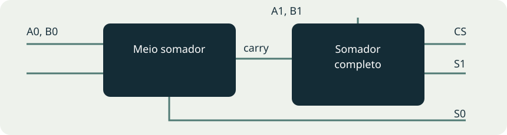

# Roteiro 07 — Meio somador e somador completo

**Bruno Neves · Ciência da Computação · UNIP · 1º semestre**

## Conceito

O meio somador recebe dois bits A e B. A saída S contém o bit da soma, e C contém o vai-um. O somador completo acrescenta uma entrada CE, que recebe o carry do estágio anterior. As saídas são o bit S e o carry CS que segue para o próximo estágio.

## Experimente a soma

## Meio somador

`S = A ⊕ B` e `C = A·B`.

| A | B | C | S |
| --- | --- | --- | --- |
| 0 | 0 | 0 | 0 |
| 0 | 1 | 0 | 1 |
| 1 | 0 | 0 | 1 |
| 1 | 1 | 1 | 0 |

## Somador completo

`S = A ⊕ B ⊕ CE` e `CS = A·B + CE·(A ⊕ B)`.

| A | B | CE | CS | S |
| --- | --- | --- | --- | --- |
| 0 | 0 | 0 | 0 | 0 |
| 0 | 0 | 1 | 0 | 1 |
| 0 | 1 | 0 | 0 | 1 |
| 0 | 1 | 1 | 1 | 0 |
| 1 | 0 | 0 | 0 | 1 |
| 1 | 0 | 1 | 1 | 0 |
| 1 | 1 | 0 | 1 | 0 |
| 1 | 1 | 1 | 1 | 1 |

## Ampliação: soma de dois números de dois bits

Use um meio somador para A0 e B0. Seu carry alimenta CE de um somador completo, que recebe A1 e B1. O resultado tem três bits: `CS S1 S0`. Por exemplo, `11₂ + 01₂ = 100₂` e `11₂ + 11₂ = 110₂`.

| A / B | 00 | 01 | 10 | 11 |
| --- | --- | --- | --- | --- |
| 00 | 000 | 001 | 010 | 011 |
| 01 | 001 | 010 | 011 | 100 |
| 10 | 010 | 011 | 100 | 101 |
| 11 | 011 | 100 | 101 | 110 |

## Registro da prática

As tabelas e a ligação entre estágios foram verificadas matematicamente. O relatório fornecido não contém capturas deste roteiro; os diagramas são ilustrações do livro. Para registrar a simulação no CircuitVerse, teste as quatro combinações do meio somador, as oito do somador completo e exemplos com e sem carry na soma de dois bits.

**Referências:** UNIP, Circuitos Lógicos Digitais, roteiro 7. As tabelas do livro foram calculadas a partir das expressões indicadas; as visualizações interativas são demonstrações didáticas.
