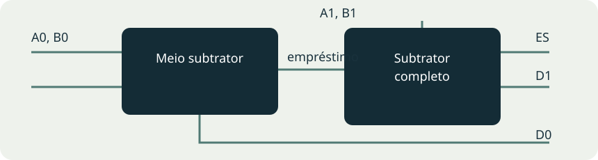

# Roteiro 08 — Meio subtrator e subtrator completo

**Bruno Neves · Ciência da Computação · UNIP · 1º semestre**

## Conceito

O meio subtrator calcula A−B. A diferença fica em D, enquanto E indica a necessidade de empréstimo quando A é menor que B. O subtrator completo também recebe EE, o empréstimo vindo do estágio menos significativo, e produz ES para o próximo estágio. Nos termos do roteiro, o empréstimo é chamado de “desce 1”.

## Experimente a subtração

## Meio subtrator

`D = A ⊕ B` e `E = ¬A·B`.

| A | B | E | D |
| --- | --- | --- | --- |
| 0 | 0 | 0 | 0 |
| 0 | 1 | 1 | 1 |
| 1 | 0 | 0 | 1 |
| 1 | 1 | 0 | 0 |

## Subtrator completo

`D = A ⊕ B ⊕ EE` e `ES = ¬A·B + ¬(A ⊕ B)·EE`.

| A | B | EE | ES | D |
| --- | --- | --- | --- | --- |
| 0 | 0 | 0 | 0 | 0 |
| 0 | 0 | 1 | 1 | 1 |
| 0 | 1 | 0 | 1 | 1 |
| 0 | 1 | 1 | 1 | 0 |
| 1 | 0 | 0 | 0 | 1 |
| 1 | 0 | 1 | 0 | 0 |
| 1 | 1 | 0 | 0 | 0 |
| 1 | 1 | 1 | 1 | 1 |

## Ampliação: subtração de dois números de dois bits

O meio subtrator trata A0−B0. Seu empréstimo alimenta EE do subtrator completo, que trata A1−B1. O resultado de dois bits é o resto módulo 4; o empréstimo final indica que A é menor que B.

Exemplo: `01₂ − 10₂` produz diferença `11₂` e empréstimo 1. O valor inteiro é `3 − 4×1 = −1`; o par empréstimo/diferença não deve ser lido como um número binário positivo de três bits.

| A / B | 00 | 01 | 10 | 11 |
| --- | --- | --- | --- | --- |
| 00 | 00; E=0 | 11; E=1 | 10; E=1 | 01; E=1 |
| 01 | 01; E=0 | 00; E=0 | 11; E=1 | 10; E=1 |
| 10 | 10; E=0 | 01; E=0 | 00; E=0 | 11; E=1 |
| 11 | 11; E=0 | 10; E=0 | 01; E=0 | 00; E=0 |

## Registro da prática

O relatório fornecido não contém capturas deste roteiro. As tabelas e a propagação de empréstimo foram verificadas matematicamente; os diagramas são ilustrações didáticas. Para registrar a simulação no CircuitVerse, teste as quatro combinações do meio subtrator, as oito do completo e exemplos como 3−1, 2−1 e 1−2.

**Referências:** UNIP, Circuitos Lógicos Digitais, roteiro 8. As tabelas do livro foram calculadas a partir das expressões indicadas; as visualizações interativas são demonstrações didáticas.
